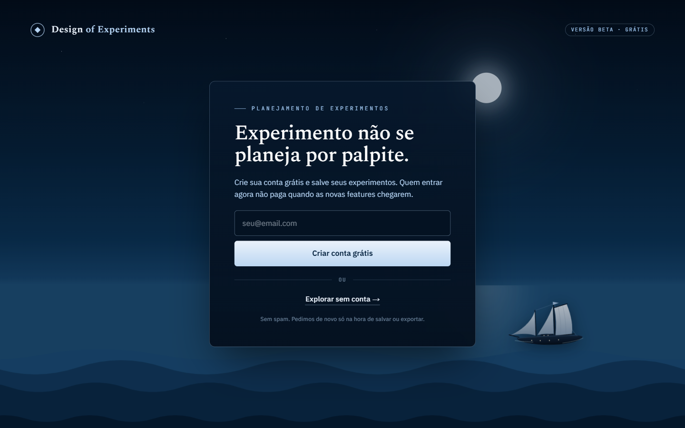
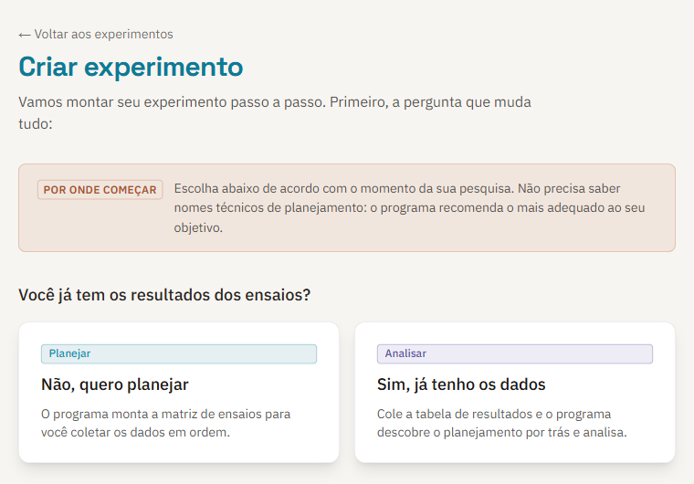
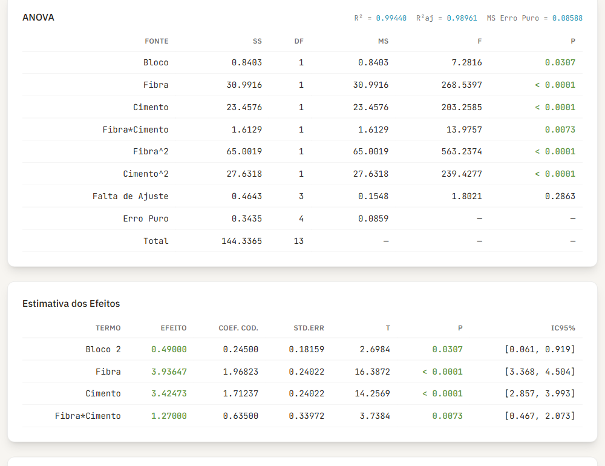
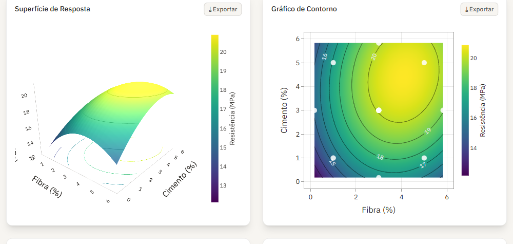
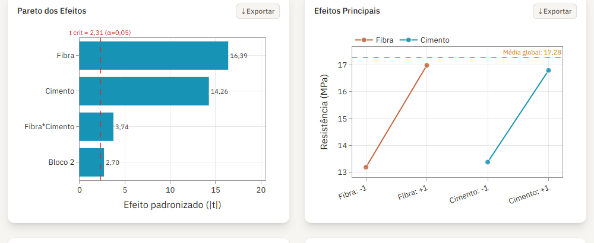
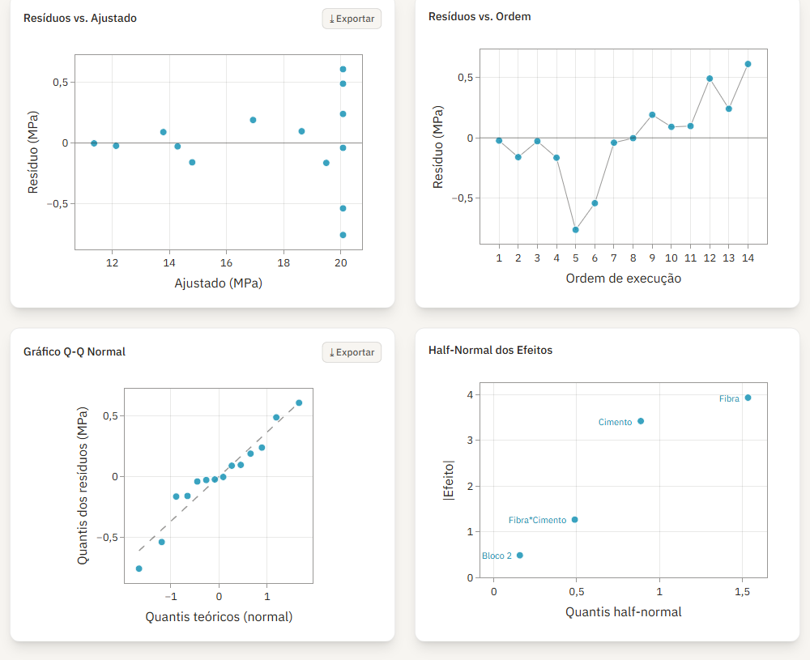
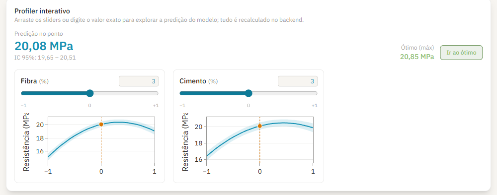

# Design of Experiments

**Planejamento e análise de experimentos, de graça, direto no navegador.**

Uma plataforma para quem faz pesquisa experimental e precisa planejar ensaios, rodar a ANOVA e sair com gráficos prontos para a tese ou para o artigo, sem pagar licença de software estatístico.

Você descreve os fatores, o programa recomenda o planejamento, gera a matriz de ensaios com a ordem sorteada e, quando os resultados chegam, entrega a análise completa: ANOVA, efeitos, coeficientes, superfície de resposta, diagnóstico dos resíduos e o ponto ótimo.

[Usar online](https://research.iacommurilo.com.br) · [Material didático](https://research.iacommurilo.com.br/conteudo) · [Como citar](#como-citar)

## Por que existe

Planejamento de experimentos é uma das ferramentas mais úteis da pesquisa em engenharia, e uma das menos usadas. O motivo costuma ser prático: os programas que fazem bem esse trabalho são caros, e as alternativas gratuitas exigem programar a análise do zero.

Este projeto nasceu nas aulas de planejamento de experimentos e da vontade de deixar aquele conteúdo ao alcance de qualquer pesquisador. Cada conta que a plataforma faz foi conferida contra os exemplos resolvidos em aula, para que o resultado mereça confiança.

## O que ele faz



**Planeja.** Um assistente guiado pergunta o que você quer descobrir e recomenda o planejamento adequado. Não é preciso saber o nome técnico de cada desenho.

**Analisa dados antigos.** Já rodou os ensaios sem planejar? Cole a tabela e o programa reconhece o planejamento por trás dos dados, avisa o que não dá para estimar e analisa o que dá.

**Explica.** Cada tela traz uma orientação de leitura, e o assistente sugere o próximo passo, como trocar para um modelo quadrático quando a falta de ajuste acusa.

<br clear="right" />

### Planejamentos disponíveis

| Objetivo | Planejamentos |
| --- | --- |
| Triagem de muitos fatores | Fatorial fracionado 2^(k-p), Plackett-Burman, Definitive Screening Design |
| Efeitos e interações | Fatorial completo 2^k, fatorial geral 3^k e de níveis mistos |
| Superfície de resposta e ótimo | Composto central (CCD), Box-Behnken |
| Robustez | Arranjos ortogonais de Taguchi com razão sinal/ruído |
| Restrições de orçamento ou região | Planejamentos D-ótimo e I-ótimo |

Blocos, réplicas e pontos centrais entram em qualquer um deles.

### A análise



ANOVA com erro puro, falta de ajuste e teste de curvatura; efeitos com intervalo de confiança; coeficientes nas unidades codificadas e originais, com VIF; R², R² ajustado e R² de predição. Em planejamentos saturados, sem graus de liberdade para o erro, o método de Lenth assume a decisão.





<details>
<summary>Ver o diagnóstico do ajuste e o profiler</summary>



O profiler mostra como cada fator move a resposta, com a faixa de confiança, e leva direto ao ponto ótimo.



</details>

### Saídas para publicação

Todo gráfico sai em PNG, SVG, PDF ou TIFF, até 1200 DPI, no estilo de revista científica. As tabelas saem em CSV e Excel, e um clique gera o relatório completo da análise em PDF.

## Como funciona

O cálculo é feito em Python, com as bibliotecas que a comunidade científica já usa: statsmodels para a regressão e a ANOVA, SciPy e NumPy para a estatística, pyDOE3 para gerar os planejamentos e Matplotlib com SciencePlots para as figuras de publicação.

O mesmo código Python roda dentro do navegador, compilado para WebAssembly com Pyodide. Na primeira visita o ambiente leva cerca de um minuto para carregar e depois fica salvo. Seus dados ficam no seu computador: nada é enviado a um servidor para ser analisado.

A interface é feita em Next.js, TypeScript e Tailwind, com gráficos interativos em Plotly. Toda conta acontece no Python, e a interface só desenha o que recebe pronto. Assim existe uma única fonte de verdade para cada número.

Alguns cuidados que fazem diferença no resultado:

- **Estimabilidade verificada.** Antes de reportar um modelo, o programa confere o posto da matriz. Em planejamento singular, o software estatístico costuma devolver números plausíveis e errados; aqui ele avisa e não reporta.
- **Codificação explícita.** Os níveis são codificados em -1 e +1 de forma direta, sem contrastes automáticos que podem inverter o sinal de um efeito sem aviso.
- **Conferência com a aula.** Os testes reproduzem os exemplos resolvidos em sala, e os resultados batem com o OriginPro até a quinta casa decimal. Qualquer divergência trava a entrega.

## Como foi criado

O conteúdo vem das aulas. A partir delas foram escritos cinco cadernos de estudo em LaTeX, que estão na pasta [`apostilas`](apostilas), cobrindo do porquê de planejar até a economia de ensaios. Cada caderno indica de onde veio cada exemplo.

A plataforma foi construída com o Claude Code, seguindo um fluxo dirigido por especificação: levantamento de requisitos, documento do produto, fatiamento em tarefas, implementação com testes e verificação antes de cada entrega. Os exemplos numéricos das aulas viraram testes automáticos, e foi isso que permitiu crescer o programa sem perder a confiança nas contas.

## Agradecimentos

Este trabalho só existe por causa de quem ensinou o assunto.

**Prof. Fernando Peixoto**, do Instituto Militar de Engenharia (IME), pela disciplina Tópicos Especiais em Planejamento de Experimentos. Os exemplos, a ordem do conteúdo e boa parte dos casos usados nos testes vêm das suas aulas.

**Prof. Bruno Oechsler**, da Universidade Federal de Santa Catarina (UFSC), pelo material da disciplina Planejamento de Experimentos e Estimação de Parâmetros, do Programa de Pós-Graduação em Engenharia Química, que orientou a parte de superfície de resposta.

Os materiais originais das aulas pertencem aos professores e não estão neste repositório. O que está aqui é uma compilação própria, feita para estudo, com as fontes indicadas.

## Rodar localmente

```bash
# motor de análise (Python 3.12)
cd backend
pip install -r requirements.txt
uvicorn main:app --reload --port 8000

# interface
cd frontend
npm install
npm run dev
```

Abra `http://localhost:3000`. Os testes rodam com `pytest` no backend e `npm test` no frontend.

## Como citar

Se a plataforma ajudou no seu trabalho, a citação ajuda o projeto a continuar.

> NARCISO, M. M. **Design of Experiments (DoE_programa)**: plataforma gratuita de planejamento e análise de experimentos. Versão 1.0.0. 2026. Software.

O GitHub também gera a citação pelo botão *Cite this repository*, a partir do arquivo [`CITATION.cff`](CITATION.cff).

## Licença

Código aberto sob a [licença MIT](LICENSE). Pode usar, adaptar e redistribuir, mantendo o crédito.

Feito por [Murilo Narciso](https://github.com/murilomn58) · Engenharia pelo IME · [LinkedIn](https://www.linkedin.com/in/murilonarciso/)
